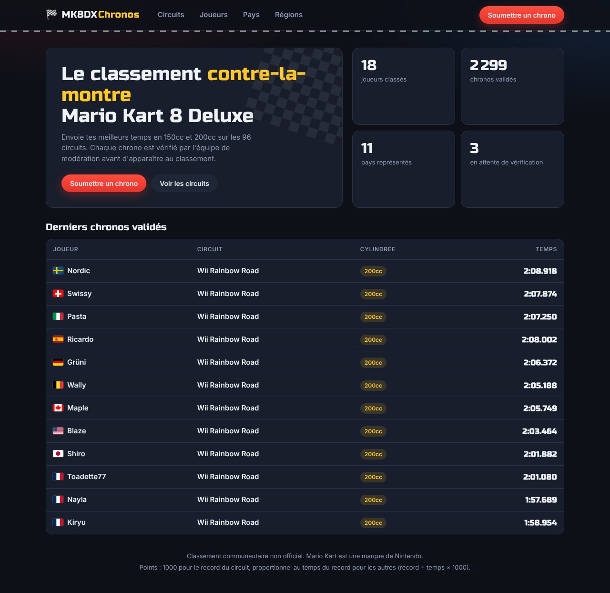
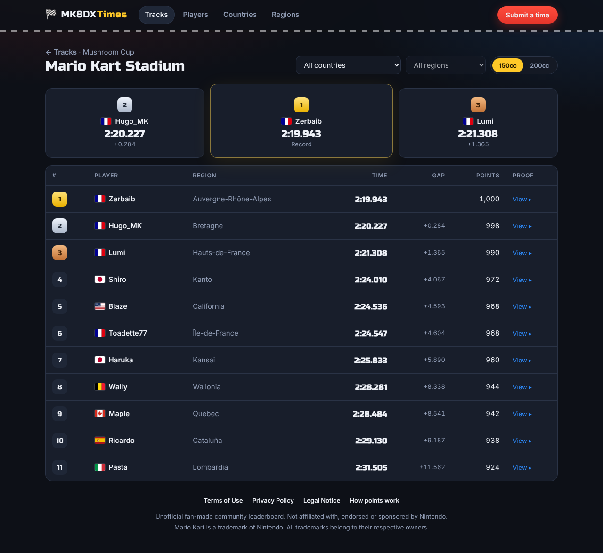
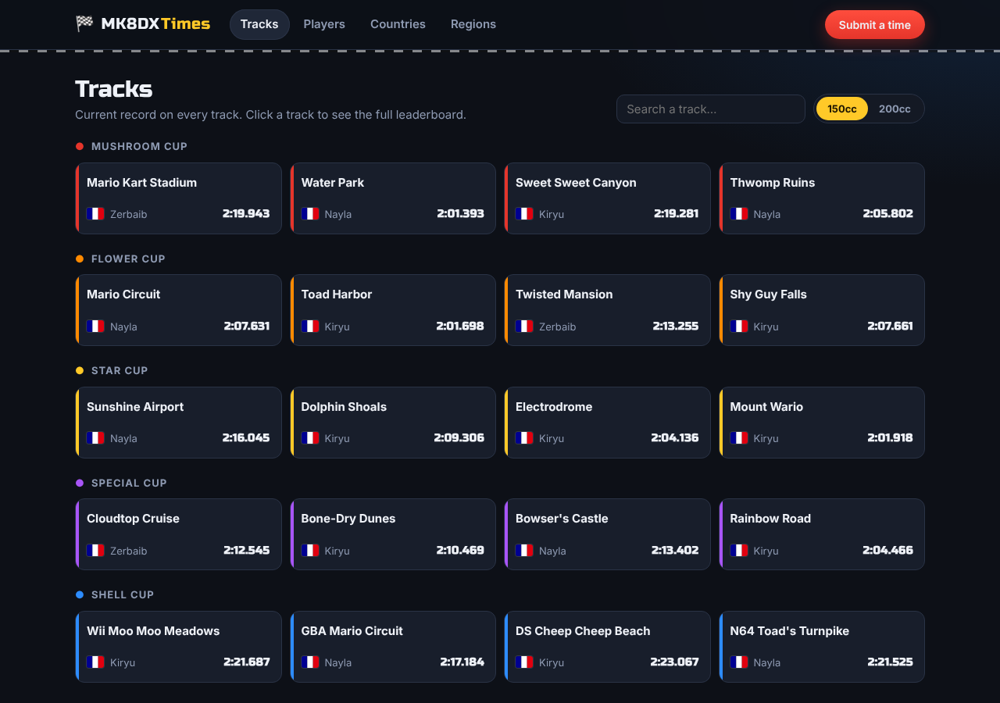
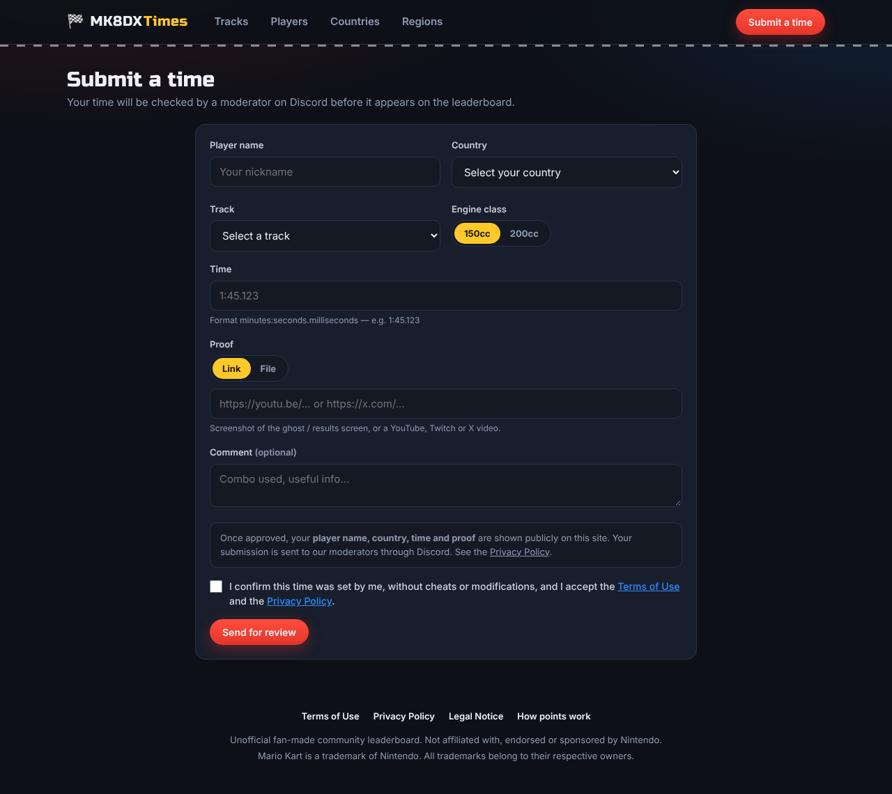
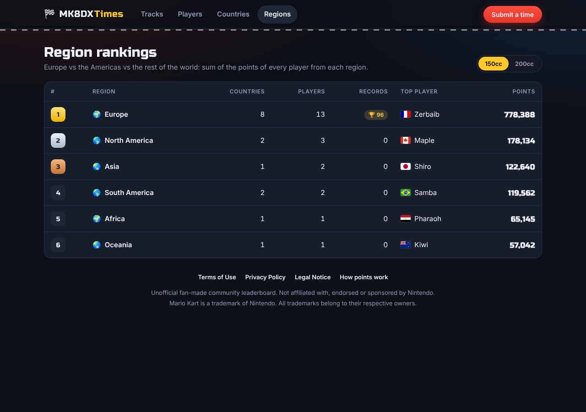
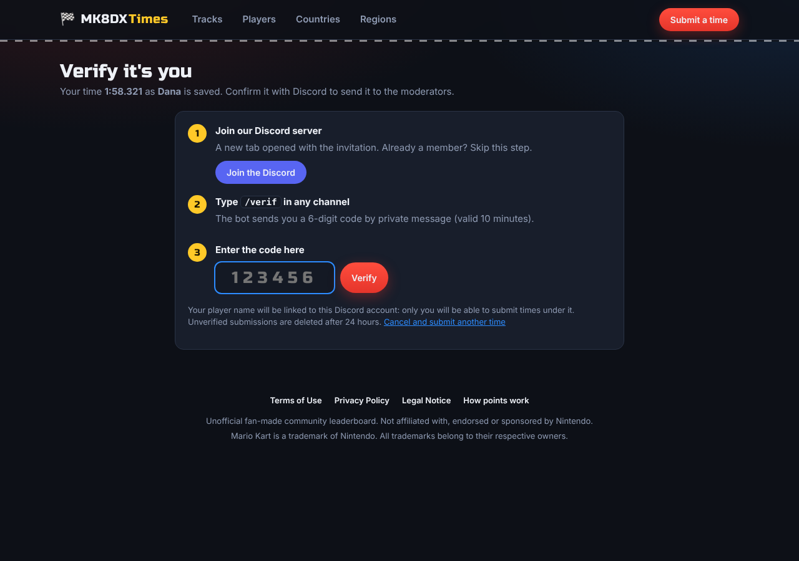

# 🏁 MK8DX Times — Mario Kart 8 Deluxe leaderboard

A time trial leaderboard for **Mario Kart 8 Deluxe** (150cc and 200cc, all 96 tracks including the Booster Course Pass).

- Players submit their times through a form (player name, country, track, engine class, time, proof as a **link** or an **uploaded file**).
- After submitting, the player confirms it's them on **Discord**: a tab opens with the server invite, they type `/verif`,
  the bot DMs them a 6-digit code and they enter it on the site. Their player name is then linked to their Discord account.
- Each verified submission is posted on **Discord** with two buttons: **✅ Approve** / **❌ Reject** (with an optional reason).
- Only approved times appear on the leaderboards: **per track**, **players**, **countries** and **world regions**
  (Europe, North America, South America, Asia, Africa, Oceania — deduced automatically from the player's country).
- Data is stored in a **SQLite** database (`data/leaderboard.db`).
- Includes **Terms of Use**, **Privacy Policy** (GDPR), **Legal Notice** and a "How points work" page.



| Track leaderboard | Tracks |
|---|---|
|  |  |
| **Submission form** | **Region rankings** |
|  |  |

## Setup

Requires **Node.js 22 or later** (`better-sqlite3` does not support older versions). On Debian/Ubuntu:

```bash
curl -fsSL https://deb.nodesource.com/setup_22.x | bash -
apt install -y nodejs
```

```bash
npm install
cp .env.example .env   # then fill in the variables
npm start              # http://localhost:3000
```

To try it with fake data: `npm run seed` (do not run it in production).

## Search engines (SEO)

Every page is rendered on the server, so search engines receive the complete content (no JavaScript needed),
and the browser then navigates between pages without reloading.

- Real addresses: `/tracks`, `/track/wii-rainbow-road/200cc`, `/players?cc=200`, `/player/12`, `/countries`, `/regions`…
  Old links like `/#/track/big-blue` are redirected automatically.
- Each page has its own title, description and canonical URL
  (e.g. *"Wii Rainbow Road 200cc World Record – Mario Kart 8 Deluxe"*, with the current record in the description).
- Social previews (Open Graph / Twitter cards) with `public/og-image.png`.
- Structured data (schema.org): `WebSite`, `Organization`, `BreadcrumbList`, `ItemList` (track leaderboards), `ProfilePage` (players).
- `/sitemap.xml` (all pages, with the date of the last approved time) and `/robots.txt`.

The absolute URLs (canonical, sitemap, previews) use `LEGAL_SITE_URL`, or `PUBLIC_URL` if it is not set:
set it to your real address (e.g. `https://mk8dxtimes.com`).

Then add the site to [Google Search Console](https://search.google.com/search-console) and submit `https://your-domain/sitemap.xml`.

## Track images

Track cards (`/tracks`) show an image on top, and the track picker of the submission form shows a thumbnail next to each track.
**`npm run download-track-images`** downloads the 96 in-game course icons (288×162) from the Super Mario Wiki into
`public/tracks/`, converted to WebP (~1.4 MB in total) when the optional `sharp` package is installed. It only fetches the
missing images (`-- --force` to download them all again) and waits 1 s between downloads.

You can also put your own images in `public/tracks/`, named with the track id (e.g. `wii-rainbow-road.jpg`): the full list
of names is in `public/tracks/README.md`. Formats: `.webp`, `.avif`, `.jpg`, `.jpeg`, `.png`, ideally 16:9.

- New images are picked up within 2 minutes, without restarting. A missing image shows a placeholder in the cup colours.
- The images are **ignored by git** (they are not published with the code): copy them to the server directly.
- Track screenshots belong to Nintendo. When images are present, the Terms of Use and the Legal Notice say so automatically.

## Importing the current world records

`npm run import-wrs` downloads the current 150cc and 200cc world records from [mkwrs.com](https://mkwrs.com/mk8dx/)
and adds them to the database as approved times (player, country, time, date of the record, video link as proof).

- `npm run import-wrs -- --dry-run` shows what would be added without changing anything.
- Running it again only adds new records, so you can run it regularly to follow new WRs.
- Imported times are marked as reviewed by `mkwrs.com import`.
- `npm run import-wrs -- --announce` also posts the imported records on the records webhook (see below), but only those
  that beat or tie a time already in the database. Do the **first** import without `--announce` (otherwise ~190 messages).

The data belongs to mkwrs.com: credit them and ask their maintainers before importing regularly.

## Accounts (login with Discord)

Players can log in on `/account` with their Discord account (OAuth2, `identify` scope only: Discord ID, username, avatar).
The account is created automatically on the first login; the player then chooses a player name and a country
(or gets back the name they already verified with `/verif`).

Logged-in players:

- submit times **without `/verif`**: the submission goes straight to the moderators, with their Discord account shown;
- follow their submissions (pending / approved / rejected) on their account page;
- change their player name (once every 7 days, all their times follow) and their country;
- delete their account: profile, all times (approved ones included) and proof files are deleted immediately.

Players without an account can still submit with the `/verif` code, as before.

Setup:

1. Developer Portal → your application → **OAuth2**: copy the **Client ID** and **Client Secret** into
   `DISCORD_CLIENT_ID` and `DISCORD_CLIENT_SECRET`.
2. In the same page, **Redirects** → add `https://your-domain/auth/discord/callback` (it must match `PUBLIC_URL` exactly).

Cookies: a banner asks visitors to **accept or refuse** cookies on their first visit (asked again after 6 months,
"Cookie settings" link in the footer). Refusing keeps browsing and `/verif` submissions working, but blocks login
(it needs the session cookie), logs out a logged-in player and stops remembering the player name in the form.

Security: the session cookie is `HttpOnly`, `SameSite=Lax` and `Secure` over https; only a hash of the session id is stored;
the OAuth `state` is checked; account changes are refused when the request comes from another website.

## Automatic Discord roles

The bot can manage four roles (each one optional):

| Role | Who gets it |
|---|---|
| `DISCORD_VERIFIED_ROLE_ID` | every member whose Discord account is linked to a player (`/verif`, login on the site, or `/link`) |
| `DISCORD_WR_ROLE_ID` | current record holder (rank 1, ties included) on at least one track, 150cc or 200cc |
| `DISCORD_FORMER_WR_ROLE_ID` | held a record but holds none now. Imported world records (mkwrs.com) always count; a time submitted on the site only counts if another player had a time on the track meanwhile (being alone is not a record) |
| `DISCORD_TOP10_ROLE_ID` | in the top 10 of at least one track, 150cc or 200cc |

- The verified role is given **right away** when an account is linked, and removed when the account is deleted.
- When someone **joins the server** and already has an account with times, they get all their roles immediately.
- The leaderboard roles are **recomputed every `ROLE_SYNC_HOURS` hours** (48 by default): a player who drops from 9th to 11th
  loses the Top 10 role at the next sync. Moderators can run the sync at any time with **`/sync-roles`**.
- Members without a linked account lose these roles at the next sync; bots are never touched.
- **Roles given by hand** with **`/manual-role add user:@member role:<role>`** are never removed by the sync — useful for a
  former world record holder whose record is not in the site's history. `/manual-role remove` gives the decision back to
  the sync, `/manual-role list` shows them. Needs the "Manage Roles" permission (or being in `ADMIN_DISCORD_IDS`).

Setup:

1. Developer Portal → your application → **Bot** → **Privileged Gateway Intents** → enable **Server Members Intent**.
   (Without it the bot still starts, but without automatic roles, and says so in the console.)
2. Give the bot the **Manage Roles** permission, and in Server settings → **Roles**, drag the bot's role **above** the 4 roles.
3. Copy each role ID (Developer Mode → right-click the role → Copy Role ID) into `.env`.

## Admin panel

`/admin` shows the site statistics to the Discord accounts listed in `ADMIN_DISCORD_IDS` (comma-separated user IDs).
For everyone else the page does not exist (404).

- logged-in players: online now (active in the last 5 minutes), active in 24 h, logins in 24 h, open sessions;
- accounts: total, new in 24 h / 7 days / 30 days, latest accounts with their last activity;
- times: submitted in 24 h / 7 days, awaiting review, not verified yet, approved, rejected;
- charts of times submitted and new accounts per day (30 days), most submitted tracks, latest submissions.

- storage: free disk space, database size (and its WAL file), proof files size.

There are no visitor analytics: only logged-in players are counted, from their session.
To find your Discord user ID: Discord → Settings → Advanced → **Developer Mode**, then right-click your name → **Copy User ID**.

## Record announcements (webhook)

Every time an approved time **enters the top 10** of a track (and improves the player's best time), a message is posted
on a Discord webhook: player, time, rank, progress (`#7 → #3` or new entry), gap to the record, players overtaken, proof
and a link to the track page. A new record (or a tied record) has its own message with the previous record and the gap.
Times outside the top 10 are never announced.

1. In Discord: channel settings → **Integrations** → **Webhooks** → **New Webhook** → **Copy Webhook URL**.
2. Put it in `.env`: `DISCORD_RECORDS_WEBHOOK_URL=https://discord.com/api/webhooks/...`

Announcements are sent when a moderator clicks **Approve**, and by `npm run import-wrs -- --announce`.

To test it without touching the database:

- `npm run test-webhook` posts a "webhook connected" message;
- `npm run test-webhook -- --record` posts an example top 10 announcement, marked `[TEST]`.

When the site starts, the log shows `[webhook] Record announcements: enabled` (or why it is disabled),
and each announcement is logged as `[webhook] Announced: ...`.
Messages are queued 2 s apart to respect Discord's rate limit, and never ping anyone.

## Discord bot setup

Interactive buttons require a **bot** (a plain webhook cannot receive button clicks).

1. Go to <https://discord.com/developers/applications> → **New Application**.
2. **Bot** tab → **Reset Token** → copy the token into `DISCORD_TOKEN`.
3. **OAuth2 → URL Generator**: tick `bot` **and `applications.commands`**, then the permissions
   *View Channels*, *Send Messages*, *Embed Links*, *Attach Files*. Open the generated URL to invite the bot to your server.
4. In Discord, enable **Developer Mode** (Settings → Advanced), right-click the review channel → **Copy Channel ID** → `DISCORD_CHANNEL_ID`.
   Make this channel **private** (moderators only): it contains unpublished submissions.
5. (Optional) Right-click the moderator role → **Copy Role ID** → `DISCORD_MOD_ROLE_ID`.
   Without it, anyone with the **Manage Messages** permission can review.
6. Set `PUBLIC_URL` to the public address of the site (proof files too large for Discord are linked there).
7. Create a **permanent invite** to your server (Invite people → Edit invite link → Expire after: Never) and put it in `DISCORD_INVITE_URL`.
   It is opened in a new tab when someone submits a time.

No privileged intent is needed. The slash commands are registered automatically on the server of `DISCORD_CHANNEL_ID` when the bot starts.

### Player verification



| Step | What happens |
|---|---|
| Submit | The time is saved but **not** sent to the moderators yet. A tab opens on `DISCORD_INVITE_URL` (only until the player's first successful verification). |
| `/verif` | The bot DMs a 6-digit code, valid 10 minutes (if DMs are closed, the code is shown only to the player in the channel). |
| Enter the code | The submission is linked to the Discord account and posted in the review channel, with the account shown. |
| Code accepted | The player receives a DM: "your time is waiting for a moderator". |
| Review | The player receives a DM when the time is approved (with their rank if they enter the top 10) or rejected. |
| Overtaken | When an approved time enters the top 10 of a track, every top 10 player it overtakes gets a DM with their new rank ("you're now #5 (was #4)", "your record was beaten", "you dropped out of the top 10"). Players tied get a DM too. |

Rules: the first verified submission links the player name to the Discord account. Afterwards only that account can submit
under that name, and one Discord account can only have one player name. Names imported from mkwrs.com are protected:
a moderator links them with **`/link player:<name> user:<@member>`** (also used to fix any link).

Protections: 5 wrong codes per submission, 20 attempts per IP every 10 minutes, a 30 s cooldown on `/verif`.
Unverified submissions are deleted after 24 hours. Without a configured bot (local tests), submissions skip verification.

## Legal pages

The Terms of Use, Privacy Policy and Legal Notice are filled in from your `.env`.
**Before going live**, set `LEGAL_OWNER_NAME`, `LEGAL_OWNER_ADDRESS`, `LEGAL_CONTACT_EMAIL`, `LEGAL_HOST_NAME` and `LEGAL_HOST_ADDRESS`:
until they are set, placeholders are highlighted in yellow on the pages.

The texts are a solid starting point for a free, non-commercial fan site run from the EU (France), but they are not legal advice — have them reviewed if your situation is different.

What the code does to match the Privacy Policy:

- explicit acceptance of the Terms / Privacy Policy is required to submit (checked server-side);
- IP addresses are only kept in memory for rate limiting, never stored;
- rejected submissions and their files are deleted automatically after `REJECTED_RETENTION_DAYS` (default 30);
- fonts and flags are self-hosted: no request to Google Fonts or any third-party CDN, no cookies, no analytics;
- erasure requests: `npm run delete-player -- "Player name"` deletes a player, all their submissions and proof files.

## Environment variables

| Variable | Description |
|---|---|
| `PORT` | HTTP port (default 3000) |
| `PUBLIC_URL` | Public URL of the site |
| `SITE_NAME` | Site name shown on the legal pages |
| `DISCORD_TOKEN` | Bot token |
| `DISCORD_CHANNEL_ID` | Channel where submissions are posted for review |
| `DISCORD_MOD_ROLE_ID` | Role allowed to review (optional) |
| `DISCORD_BOT_STATUS` | Bot status text (default `🚀 go on mk8dxtimes.com`) |
| `DISCORD_CLIENT_ID`, `DISCORD_CLIENT_SECRET` | Login with Discord (OAuth2) |
| `ADMIN_DISCORD_IDS` | Discord user IDs allowed to open `/admin` |
| `DISCORD_VERIFIED_ROLE_ID`, `DISCORD_WR_ROLE_ID`, `DISCORD_FORMER_WR_ROLE_ID`, `DISCORD_TOP10_ROLE_ID` | Roles given automatically (optional) |
| `ROLE_SYNC_HOURS` | Hours between two role syncs (default 48) |
| `LOW_DISK_WARNING_MB` | A warning is logged every hour when less than this is free (default 500) |
| `DISCORD_RECORDS_WEBHOOK_URL` | Webhook where new records are announced (optional) |
| `DISCORD_INVITE_URL` | Public invite shown on the Terms page (optional) |
| `LEGAL_SITE_URL` | Site address shown in the Terms of Use (defaults to `PUBLIC_URL`) |
| `LEGAL_OWNER_NAME`, `LEGAL_OWNER_ADDRESS`, `LEGAL_CONTACT_EMAIL` | Publisher information |
| `LEGAL_HOST_NAME`, `LEGAL_HOST_ADDRESS` | Hosting provider information |
| `REJECTED_RETENTION_DAYS` | Days before rejected submissions are deleted (default 30) |
| `DB_PATH` | SQLite database path (default `data/leaderboard.db`) |
| `MAX_UPLOAD_MB` | Max proof file size (default 50) |
| `RATE_LIMIT` | Max submissions per IP every 10 minutes (default 10) |

## Points

For each track and engine class, only a player's **best approved time** counts.

- Points = `1000 × record time ÷ player time` (the record holder gets 1,000 points).
- **Players**: sum of points across all tracks.
- **Countries / regions**: sum of the points of their players.
  The country → region mapping is in `src/countries.js` (North America includes Central America and the Caribbean; Asia includes the Middle East; Turkey and the Caucasus are in Europe).

## Project structure

```
src/server.js             Express API, submissions (uploads via multer), HTML pages
src/pages.js              Server-side rendering, sitemap.xml, robots.txt
src/auth.js               Login with Discord, sessions, account API
src/template.html         HTML shell of every page
src/db.js                 SQLite schema and leaderboard queries
src/discord.js            Discord bot: posts submissions, Approve/Reject buttons
src/tracks.js             The 96 tracks
src/countries.js          Countries and their world region
public/render.js          Page rendering shared by the server and the browser (incl. legal pages)
public/app.js             Browser: navigation, filters, submission form, Discord verification
scripts/seed.js           Demo data
scripts/delete-player.js  Erasure of a player's data
```

## API

| Route | Description |
|---|---|
| `GET /api/page?path=/track/big-blue/150cc` | Data of a page (used for navigation without reload) |
| `POST /api/submissions` | Submit a time (multipart) |
| `GET /api/leaderboard/track/:id?cc=150&country=FR&region=europe` | Track leaderboard |
| `GET /api/leaderboard/players?cc=150&region=north-america` | Player rankings |
| `GET /api/leaderboard/countries?cc=150` | Country rankings |
| `GET /api/leaderboard/regions?cc=150` | Region rankings |
| `GET /api/players/:id` | Player profile |
