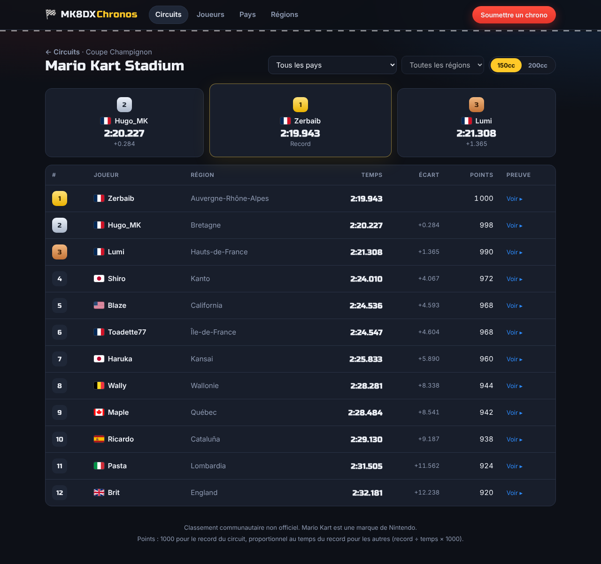
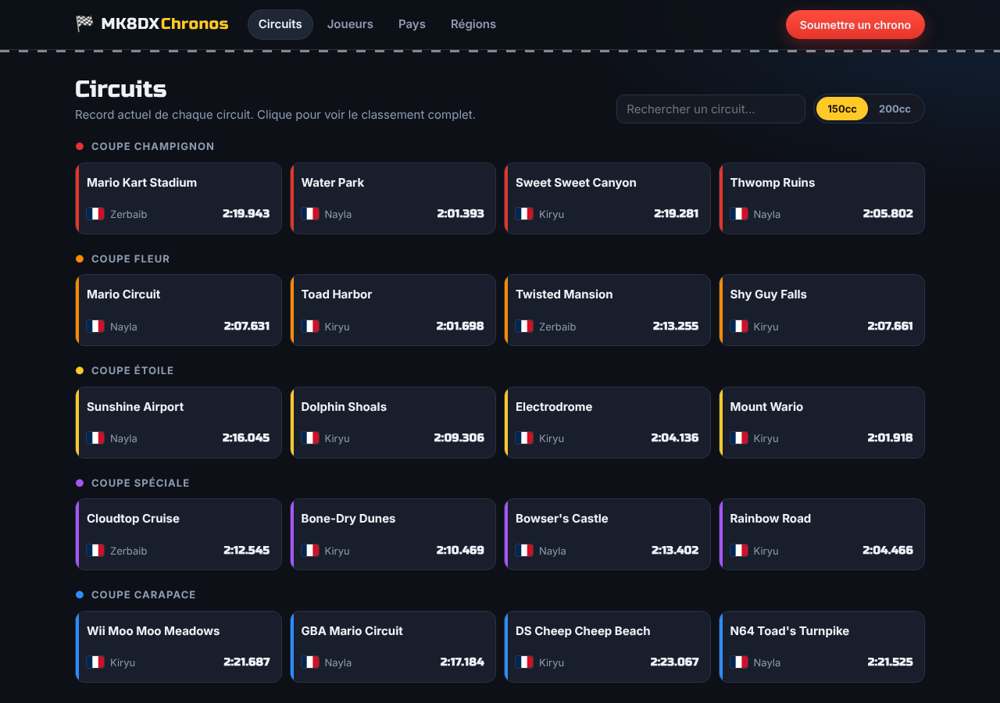
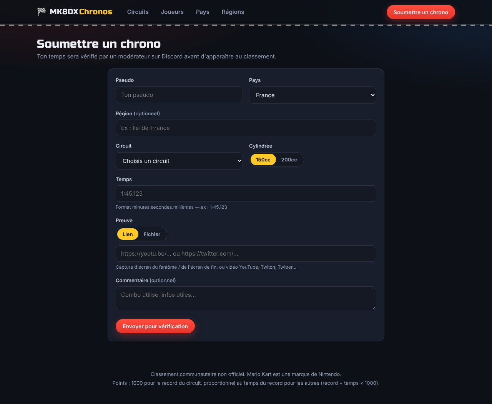

# 🏁 MK8DX Chronos — Leaderboard Mario Kart 8 Deluxe

Site de classement contre-la-montre pour **Mario Kart 8 Deluxe** (150cc et 200cc, 96 circuits, Pass inclus).

- Les joueurs envoient leurs chronos via un formulaire (pseudo, pays, région, circuit, cylindrée, temps, preuve en **lien** ou **fichier**).
- Chaque soumission arrive sur **Discord** avec deux boutons : **✅ Valider** / **❌ Refuser** (avec motif optionnel).
- Seuls les chronos validés apparaissent dans les classements : **par circuit**, **par joueur**, **par pays** et **par région**.
- Données stockées dans une base **SQLite** (`data/leaderboard.db`).


| Circuit | Circuits |
|---|---|
|  |  |
| **Formulaire** | **Régions** |
|  |  |

## Installation

Node.js 18 ou plus récent.

```bash
npm install
cp .env.example .env   # puis remplis les variables
npm start              # http://localhost:3000
```

Pour tester avec des données fictives : `npm run seed` (à ne pas lancer en production).

## Configuration du bot Discord

Les boutons interactifs nécessitent un **bot** (un simple webhook ne peut pas recevoir les clics).

1. Va sur <https://discord.com/developers/applications> → **New Application**.
2. Onglet **Bot** → **Reset Token** → copie le token dans `DISCORD_TOKEN`.
3. Onglet **OAuth2 → URL Generator** : coche `bot`, puis les permissions
   *View Channels*, *Send Messages*, *Embed Links*, *Attach Files*. Ouvre l'URL générée pour inviter le bot sur ton serveur.
4. Dans Discord, active le **mode développeur** (Paramètres → Avancés), clic droit sur le salon de modération → **Copier l'identifiant** → `DISCORD_CHANNEL_ID`.
5. (Optionnel) Clic droit sur le rôle des modérateurs → **Copier l'identifiant** → `DISCORD_MOD_ROLE_ID`.
   Sans rôle configuré, toute personne ayant la permission **Gérer les messages** peut valider.
6. Renseigne `PUBLIC_URL` avec l'adresse publique du site (les fichiers de preuve trop lourds pour Discord y sont liés).

Aucun intent privilégié n'est nécessaire.

## Variables d'environnement

| Variable | Description |
|---|---|
| `PORT` | Port HTTP (défaut 3000) |
| `PUBLIC_URL` | URL publique du site |
| `DISCORD_TOKEN` | Token du bot |
| `DISCORD_CHANNEL_ID` | Salon où arrivent les chronos à vérifier |
| `DISCORD_MOD_ROLE_ID` | Rôle autorisé à valider (optionnel) |
| `DB_PATH` | Chemin de la base SQLite (défaut `data/leaderboard.db`) |
| `MAX_UPLOAD_MB` | Taille max des fichiers de preuve (défaut 50) |
| `RATE_LIMIT` | Soumissions max par IP toutes les 10 min (défaut 10) |

## Système de points

Pour chaque circuit et cylindrée, seul le **meilleur temps validé** de chaque joueur compte.

- Points = `1000 × temps du record ÷ temps du joueur` (le recordman a 1000 points).
- **Joueurs** : somme des points sur tous les circuits.
- **Pays / Régions** : somme des points des joueurs du pays / de la région.

## Structure

```
src/server.js     API Express + formulaire (upload via multer)
src/db.js         Schéma SQLite et requêtes de classement
src/discord.js    Bot Discord : envoi des soumissions, boutons Valider/Refuser
src/tracks.js     Les 96 circuits
src/countries.js  Pays et suggestions de régions
public/           Front-end (HTML/CSS/JS sans framework)
scripts/seed.js   Données de démonstration
```

## API

| Route | Description |
|---|---|
| `POST /api/submissions` | Envoi d'un chrono (multipart) |
| `GET /api/leaderboard/track/:id?cc=150&country=FR&region=…` | Classement d'un circuit |
| `GET /api/leaderboard/players?cc=150&country=FR&region=…` | Classement joueurs |
| `GET /api/leaderboard/countries?cc=150` | Classement pays |
| `GET /api/leaderboard/regions?cc=150&country=FR` | Classement régions |
| `GET /api/players/:id` | Fiche joueur |
